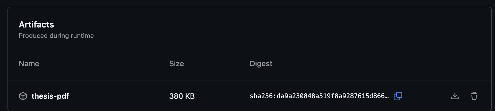

# Templat LaTeX Skripsi Universitas Negeri Malang (UM)

[](https://github.com/petrabarus/if-itb-latex/actions/workflows/build.yml)

Templat LaTeX skripsi (S-1) yang mengikuti **Pedoman Penulisan Karya Ilmiah Universitas Negeri Malang (Edisi 2017)**: margin 4/3/3/3 cm, Times New Roman 12 pt, spasi 1,5, indent paragraf 1,2 cm, penomoran bab "BAB I" dengan subbab `1.1`, gambar/tabel bernomor per bab, dan daftar rujukan gaya APA (`biblatex-apa` + `biber`).

Diadaptasi dari templat Tesis IF-ITB oleh Petra Novandi / Steven Lolong. Silakan gunakan, modifikasi, dan sebarkan.

Silakan mengunduh, menggunakan, memodifikasi, dan menyebarkan templat ini. :)

## Memulai

Cara termudah untuk menggunakan templat ini:

1. **Fork** repositori ini di GitHub ke akun Anda.
2. **Clone** fork Anda ke komputer lokal.
3. **Tulis** tesis Anda — mulai dari `src/thesis.tex` (judul dan penulis), lalu isi berkas di `src/chapters/`.
4. **Bangun** PDF dengan `make` (lihat [Penggunaan](#penggunaan)), atau **push** ke branch `main`/`master` di fork Anda untuk membangun PDF otomatis di GitHub Actions (lihat [CI / Build Otomatis](#ci--build-otomatis)).

Anda tidak perlu mengunduh arsip ZIP atau membuat proyek LaTeX dari nol. Cukup fork, clone, tulis, dan kompilasi — lokal atau lewat GitHub Actions.

## Kebutuhan

Templat ini membutuhkan TeX Live (Linux/macOS) atau MiKTeX/TeX Live (Windows) beserta paket berikut:

- `texlive-latex-recommended`, `texlive-latex-extra`, `texlive-fonts-recommended`
- `texlive-bibtex-extra`, `biber`, `xzdec`, `texlive-lang-other`
- `latexmk`

Pada Ubuntu/Debian, instalasi dapat dilakukan dengan perintah berikut:

```bash
sudo apt-get -qq update && sudo apt-get install -y --no-install-recommends \
    texlive-latex-recommended texlive-latex-extra texlive-fonts-recommended \
    texlive-bibtex-extra biber xzdec texlive-lang-other latexmk
```

## Penggunaan

Templat ini dilengkapi skrip kompilasi. Untuk membangun dokumen:

**Linux/macOS:**

```bash
make          # bersihkan lalu bangun
make build    # bangun saja (tanpa clean)
make validate # periksa sumber LaTeX dengan chktex
make clean    # hapus artefak build
```

**Windows:**

```bat
make.bat
```

Hasil kompilasi berada di `dist/thesis.pdf`. File sementara latexmk disimpan di direktori `build/` (keduanya diabaikan oleh git).

## Struktur Proyek

```text
src/
├── thesis.tex              # Berkas utama; atur judul, penulis, dan daftar bab
├── references.bib          # Database referensi bibliografi
├── config/
│   ├── if-itb-thesis.sty   # Pengaturan format (aturan UM)
│   ├── informations.tex    # Metadata skripsi — SUNTING DI SINI SAJA
│   └── hypenation-id.tex   # Aturan pemenggalan kata Bahasa Indonesia
├── resources/
│   ├── cover-ganesha.jpg   # PLACEHOLDER logo — ganti dengan logo UM
│   ├── chapter-2-infrastructure-diagram.png
│   ├── chapter-3-sample-requirements.csv
│   └── chapter-3-sample-components.csv
└── chapters/
    ├── cover.tex           # Halaman sampul (Lampiran 1a)
    ├── logo.tex            # Lembar logo (Lampiran 2)
    ├── title-page.tex      # Halaman judul (Lampiran 3a)
    ├── approval.tex        # Persetujuan pembimbing (Lampiran 4a)
    ├── endorsement.tex     # Persetujuan & pengesahan (Lampiran 5a)
    ├── statement.tex       # Pernyataan keaslian (Lampiran 6)
    ├── abstract-id.tex     # Ringkasan (Lampiran 7a)
    ├── abstract-en.tex     # Summary (versi Inggris)
    ├── forewords.tex       # Kata pengantar
    ├── biography.tex       # Riwayat hidup (Lampiran 13)
    ├── chapter-1.tex … chapter-5.tex
    └── appendix-1.tex, appendix-2.tex
```

## Menulis Tesis

- Isi seluruh metadata (judul, penulis, NIM, jurusan, pembimbing, kata kunci, dll.) **hanya di `src/config/informations.tex`** — semua halaman front matter mengambil nilainya dari sana.
- Ganti logo di `src/resources/cover-ganesha.jpg` dengan logo UM (diameter 3 cm untuk sampul, 8 cm untuk lembar logo).
- Tulis isi bab di `src/chapters/chapter-N.tex`. Untuk menambah bab baru, buat berkas baru lalu tambahkan `\input{chapters/chapter-N}` di `thesis.tex`.
- Hierarki judul UM (Bab 8) sudah otomatis: `\chapter` → "BAB I" (tengah, kapital), `\section` → subbab kapital, `\subsection` → sub-sub bab, `\subsubsection` → bagian (miring). Nomor subbab arabic (`1.1`).
- Tambahkan referensi di `src/references.bib` dan sitasi dengan `\parencite{key}`/`\textcite{key}`. Daftar Rujukan otomatis gaya APA.
- **Gambar**: letakkan `\caption` di **bawah** gambar. **Tabel**: letakkan `\caption` di **atas** tabel (Pedoman UM). Keduanya bernomor per bab (`Gambar 3.1`, `Tabel 3.1`).

### Tabel dari CSV

Templat mendukung tabel yang diisi dari berkas CSV menggunakan paket `csvsimple` (termasuk dalam `texlive-latex-extra`). Contoh ada di Bab III (`Rancangan Solusi`):

```latex
\begin{table}[ht]
    \centering
    \caption{Kebutuhan fungsional sistem}
    \label{tab:sample-requirements}
    \csvautotabular{resources/chapter-3-sample-requirements.csv}
\end{table}
```

Tabel dengan `\caption` otomatis masuk ke **Daftar Tabel**. Simpan berkas CSV di `src/resources/` dan sesuaikan path relatif dari direktori `src/`.

## CI / Build Otomatis

GitHub Actions menjalankan job **Validate LaTeX** (`make validate` dengan chktex dan pemeriksaan berkas resource) pada pull request ke `main`/`master`. Job **Build PDF** hanya dijalankan pada push ke `main`/`master`.

Jika Anda tidak ingin membangun PDF secara lokal, cukup **push** perubahan ke branch `main` atau `master` di fork repositori Anda. GitHub Actions akan mengompilasi tesis dan mengunggah hasilnya sebagai artifact **`thesis-pdf`**. Unduh PDF terbaru dari tab **Actions** → pilih workflow run → bagian **Artifacts**:



## Changelog

Lihat [CHANGELOG.md](CHANGELOG.md) untuk riwayat perubahan.

## Kontribusi

Templat ini dapat digunakan secara gratis, akan tetapi penulis sangat berharap adanya kritik serta saran dari pengguna untuk meningkatkan kualitas hasil dan penggunaan templat ini.

Kritik dan saran dapat dikirim melalui [GitHub Issues](https://github.com/petrabarus/if-itb-latex/issues).

## Terima Kasih

- [Steven Lolong](https://github.com/steven-lolong) atas pemberian templat LaTeX yang asli.
- [Peb Ruswono Aryan](https://github.com/pebbie) atas bantuan pelengkapan struktur dokumen.
